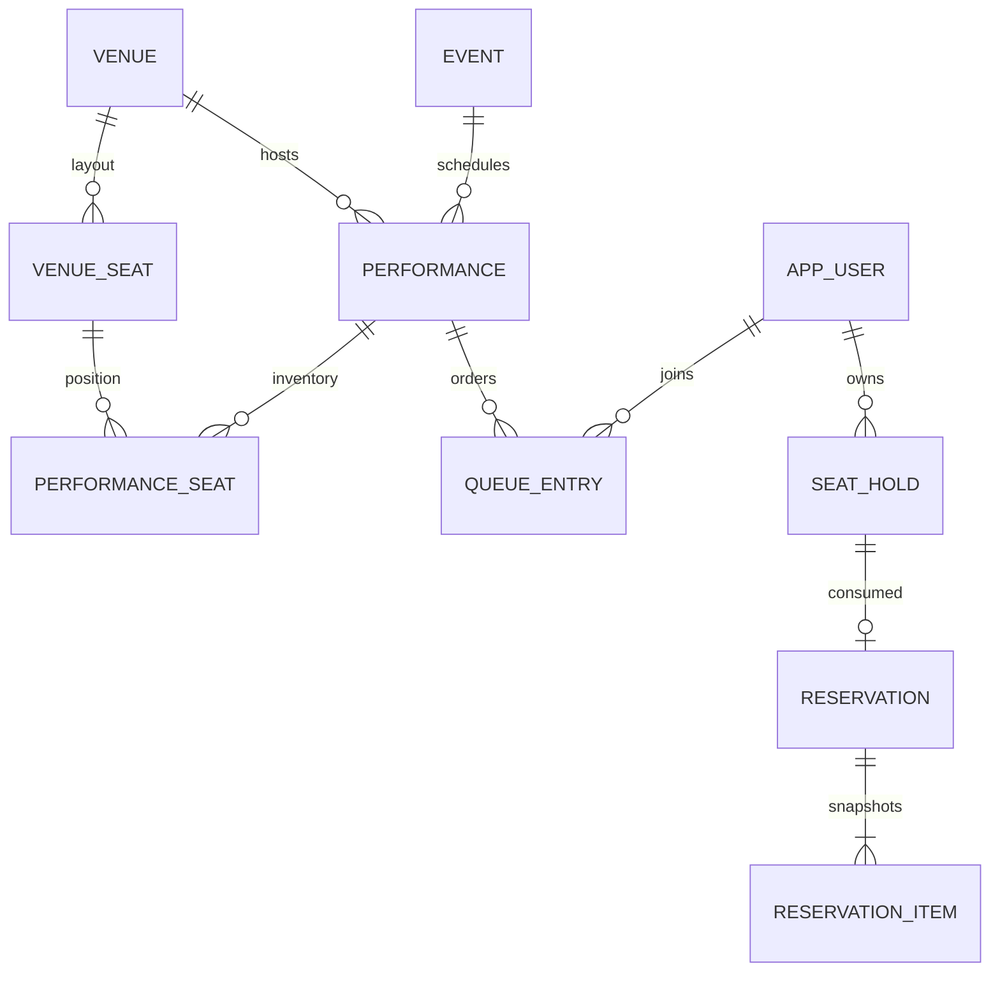

# 설계 및 보장 범위

## 기존 저장소 조사

Java 21, Spring Boot 4.0.8, Gradle 9.8.1, Spring MVC/JPA/Validation/Actuator, PostgreSQL 드라이버가 있는 초기 프로젝트였다. 도메인 구현이나 별도 저장소 규칙 파일은 없었다. 버전과 패키지 `com.ticketing.ticketbuybe`를 유지했다. Flyway, Security, Springdoc 3.1.1, 개발용 H2를 추가했다. SQL 조건부 갱신과 잠금 순서를 코드에서 명확히 검토할 수 있도록 업무 영속성은 JdbcTemplate을 사용한다. 기존 JPA 의존성은 유지하되 자동 DDL은 끈다.

## 데이터 모델

행사는 제목·설명·장르·포스터 URL을 갖고, 회차는 장소·시작·오픈·마감 시각을 갖는다. venue_seat는 공연장 고정 배치, performance_seat는 회차별 등급·가격·확보·판매 재고다. 배치를 변경해야 하는 공연장은 새 venue 식별자로 배치 버전을 만들고 기존 예매 배치를 변경하지 않는다. reservation_item은 취소·가격 변경 후에도 원래 등급/가격을 보존한다. 금액은 BIGINT 정수 KRW다. 목록 대표 회차는 판매 중 회차 우선, 다음 오픈 예정, 마지막 종료 회차 순이다. 표시 최저가는 행사 전체 회차의 최저 가격이다.

다국어 텍스트는 JSON 문자열 맵으로 저장하며 키는 `ko`, `en`, `zh-CN`이다. `lang` 쿼리 기본값은 ko, 번역 누락은 ko로 fallback한다. 관리 API는 ko 필수다. 장르·판매·재고·예매 상태는 언어 독립 코드이고 프론트에서 번역한다. PostgreSQL DB도 UTF8 인코딩으로 생성한다. 소스·마이그레이션·HTTP·Gradle 컴파일은 UTF-8이다. 포스터는 nullable URL이며 현재 시드에 실제 이미지가 없어 null이다.

## 인증 결정

- BCrypt cost 12로 비밀번호를 해시한다. 공개 회원가입은 `/auth/signup`으로 일반 USER만 생성한다. username은 영문·숫자·밑줄 4~80자이며 기존 로그인과 동일하게 대소문자를 구분한다. password는 영문·숫자 포함 공백 없는 ASCII 8~72자로 BCrypt의 72바이트 한도를 지킨다. 이름은 제어문자 없이 최대 100자이고 앞뒤 공백을 제거한다. 기존 username UNIQUE 제약으로 동시 중복 가입을 방지하며 409 USERNAME_ALREADY_EXISTS를 반환한다. 가입은 세션을 발급하지 않는다. 관리자 계정은 신뢰된 별도 프로비저닝으로 생성해야 한다. 이메일/휴대폰 인증과 비밀번호 재설정은 범위 밖이다. 개발 계정은 dev 프로필에서만 생성한다.
- 암호학적 난수 256bit opaque Bearer access token(15분), HttpOnly refresh 쿠키(7일)를 사용한다. DB에는 토큰의 SHA-256만 저장한다. 서버가 세션을 확인하므로 로그아웃·갱신 시 이전 access token도 즉시 폐기된다.
- refresh는 트랜잭션/세션 행 잠금으로 한 번만 회전 가능하다. 동시 refresh 중 하나만 성공하므로 프론트는 갱신을 single-flight로 묶는다. 만료·폐기된 refresh는 401이다. 기기별 세션을 별도로 유지한다.
- 쿠키: 이름 refresh_token, Path=/api/v1/auth, SameSite=Strict, HttpOnly, prod에서 Secure 강제. access token은 메모리에 보관하고 새로고침 시 refresh한다. 응답은 no-store. localStorage에 토큰을 저장하지 않는다.
- 브라우저 쿠키 사용 auth 변경 요청의 Origin은 허용 목록과 대조한다. refresh 쿠키는 Strict라 운영 프론트/API를 같은 site의 HTTPS 도메인으로 배치해야 한다. 서로 다른 site 배치는 현재 지원 범위가 아니다. Bearer API는 쿠키로 인증하지 않는다.
- CORS origin은 명시적 목록이다. localhost:5173 지원, credentials 허용. proxy의 신뢰할 수 없는 X-Forwarded-For는 사용하지 않는다.
- 민감 정보·SQL 인자·요청 본문·헤더는 로깅하지 않는다. 공통 오류는 traceId를 응답 헤더/본문에 포함한다. 프록시/APM도 Authorization/Cookie/비밀번호를 기록하지 않도록 구성해야 한다.
- 프로세스별 peer IP 제한: auth 30회/분, 나머지 API 240회/분, 초과 시 429/Retry-After=60. 운영 다중 인스턴스의 전역 요청 제한은 gateway/공유 rate limiter를 추가해야 한다. 토큰 만료/로그아웃/권한 검증은 DB 기반으로 인스턴스 간 공유된다.

## 대기열 저장소와 상태

PostgreSQL queue_entry를 사용한다. 좌석 DB와 동일 트랜잭션 안에서 입장 검증·만료·확보를 제어하고, 다중 인스턴스에서도 중복 진입을 UNIQUE(performance_id,user_id)로 방지하기 위해 선택했다. Redis 별도 장애/복구·DB 간 원자성 문제가 없다. 회차별 행 잠금이 처리량 한계이므로 대규모 트래픽에서는 측정 후 Redis 입장 제어 및 DB 최종 검증을 도입할 수 있다. 현재 3만 명 규모 부하 성능을 보증하는 구현은 아니다.

`POST queue`: 최초 WAITING, 자리가 있으면 즉시 ADMITTED. 활성 중복 진입은 기존 순번/토큰 유지. EXPIRED/CANCELLED 재진입은 새 순번으로 줄 끝에 배치된다. `ticketNumber`는 회차별 누적 발급 순번(1부터)으로 감소하지 않는다. `aheadCount`는 현재 자신보다 앞선 WAITING 인원만 센다. 이미 입장한 인원은 포함하지 않는다. ADMITTED/종료 상태의 aheadCount는 0이다. 신규 사용자는 앞선 대기자가 먼저 승격된 뒤 남은 용량에 입장한다.

ADMITTED 토큰은 사용자/회차/만료에 귀속되며 기본 10분, 재조회로 연장되지 않는다. 만료는 EXPIRED, 취소는 CANCELLED. `estimatedWaitSeconds=null`: 실제 유입/처리 시간 관측 모델이 없어 정확도를 가장하지 않는다. pollAfterSeconds는 WAITING 등 3초, ADMITTED 30초. 판매 마감 시 남은 WAITING/ADMITTED는 EXPIRED가 된다. 미진입 조회는 404다. 진행률은 총 대기 인원 기준치가 없으므로 제공하지 않으며 프론트는 대기번호와 앞선 인원을 표시한다.

입장 토큰은 좌석 조회/확보/신규 예매 생성에 필수. 프론트 화면 이동이나 fake 토큰으로 우회할 수 없다. 대기 취소는 해당 사용자의 활성 확보도 해제한다. 폴링과 10초 주기 worker가 만료 및 다음 입장을 진행한다. 시뮬레이션·바로 입장 endpoint 자체를 만들지 않았으므로 운영 우회 경로가 없다. dev 시드도 실제 DB 대기열을 사용한다.

## 좌석 동시성과 만료

대기열/좌석 변경 경로는 먼저 performance 행에 SELECT FOR UPDATE를 수행한다. 동일 회차 전체가 직렬화되어 여러 인스턴스에서도 입장 용량, 사용자별 활성 확보 최대 4석, 만료 처리, 취소, 좌석 판매를 일관되게 판단한다. 서로 다른 회차는 독립 진행된다. reserve는 먼저 사용자 행을 잠가 사용자 멱등성 키가 서로 다른 회차에서도 충돌하지 않게 한다. 다른 경로는 사용자 행을 잠그지 않으므로 역순 잠금이 없다. UPDATE는 hold_id/reservation_id가 모두 NULL인 조건을 재검증한다. 하나라도 확보 실패하면 전체 트랜잭션이 rollback되어 부분 확보가 없다.

확보는 기본 5분. 판매·활성 확보 합계는 서버 가격으로만 계산한다. 요청마다 만료 좌석을 정리하며 worker가 기본 10초마다 물리적 참조를 해제한다. 만료 후 확정은 즉시 거부한다. 실패 트랜잭션에서 정리 변경도 rollback될 수 있지만 다음 정상 조회/worker가 정리하며 만료 시각 검증은 항상 적용된다. 입장 만료와 확보 만료는 별개이며 예매 시 둘 다 유효해야 한다. 입장 시간이 얼마 안 남았다면 프론트가 이를 표시해야 한다.

## 멱등성과 결제 정책

reserve는 필수 Idempotency-Key(사용자 범위, 1~100자)와 holdId를 받는다. DB UNIQUE(user_id,idempotency_key), UNIQUE(hold_id)와 사용자 잠금이 중복 예매를 막는다. 동일 키/hold는 원래 예매 반환(201, 취소된 예매도 동일 반환); 다른 hold로 키 재사용은 409. 소비한 hold를 새 키로 제출해도 409. 첫 요청이 실패하여 rollback되면 키는 소비되지 않는다. 이미 성공한 재시도는 새 판매 변경을 만들지 않으므로 재인증만 하고 기존 결과를 반환한다(입장 만료 후에도 가능).

이번 서비스 정책은 결제 없이 예매를 생성하는 `CONFIRMED + NOT_REQUIRED`다. 운영에서도 이 정책은 동일하며 유료 결제 완료라고 표시하면 안 된다. 개발용 가상 결제/관리자 강제 확정 API는 없다. 예매 취소는 공연 시작 전 가능, `CANCELLED + NOT_REQUIRED`, 좌석은 재판매된다. PG를 도입하려면 PENDING_PAYMENT, PAID, REFUNDED 등 결제 수명주기, webhook 검증, 결제 실패 보상 및 재고 정책을 별도로 설계해야 한다. 현재 API를 결제 완료 증빙으로 사용할 수 없다.

## 운영 한계

카탈로그/콘텐츠 검색은 언어 fallback을 일관되게 처리하기 위해 전체 후보를 읽어 메모리에서 필터/정렬한다. 대량 데이터에서는 번역 테이블/DB 검색 인덱스와 SQL 페이지네이션으로 바꿔야 한다. 대기열 성능, 분산 요청 제한, 부하/장애 복구, PG, 계정 프로비저닝, 행사/배치 운영 CRUD, 이미지 업로드는 추가 작업이다. 관리자 콘텐츠 API는 plain text이며 프론트에서 HTML로 주입하지 않는다. Swagger는 prod 기본 비활성, 필요할 때만 신뢰된 환경에서 활성화한다. 기존 dev DB를 운영 DB로 재사용하면 안 된다.
